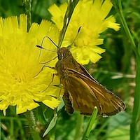



I was one of the authors on a new short note:

> Shinichi Nakahara, Richard Littauer, John V. Calhoun (2026). A new name is not needed for _Hesperia zachaeus_ Plötz, 1883, *nec* Fabricius, 1798 (Lepidoptera: Riodinidae, Hesperiidae). *Zootaxa 5897(5)*: 598–600. [https://doi.org/10.11646/zootaxa.5897.5.12](https://doi.org/10.11646/zootaxa.5897.5.12)

The paper was largely Nakahara's concept, and he wrote most of it. In short, two authors used the same name for a butterfly in 1798 and 1883, and normally this means that one of the names should be replaced. We argue this isn't necessary, because the names don't really refer to a clear taxon. They're dubious at best, or, in Latin, *nomina dubia*. The genus of butterflies is called *Hesperia*: an example from Vermont is in the photo.

I had some fun in the middle analyzing the etymology of variants of *zachaeus* which showed up through the years: *zachea*, *zacheus*, and _Zachæus_. None of these names are exactly the same as *zachaeus*, for different reasons - the first two are misspellings, and the last is an incorrect original spelling under the International Code of Zoological Nomenclature which needs to be amended to *zachaeus*. Capitalization and digraphs don't work for species names in the Code.

This paper was fun for another reason - we got to quote Art. 23.9.5:

> When an author discovers that a species-group name **in use** [emphasis added] is a junior primary homonym [Art. 53.3] of another species-group name also in use, but the names apply to taxa not considered congeneric after 1899, the author must not automatically replace the junior homonym; the case should be referred to the Commission for a ruling under the plenary power and meanwhile prevailing usage of both names is to be maintained [Art. 82].

This name is close to being applied here - but no one currently accepts this name as valid, so it is not considered in use. Instead, both versions of the name *zachaeus* are *nomina dubia*, meaning we're not quite sure what butterflies they refer to. So this paper is a long way of saying: "We don't need a new name, it's unclear what butterfly this is, and the later name is also kind of not useful."

Taxonomy is a puzzle. Like any puzzle, it can be fun to figure out.

The paper is only a couple of pages, and it's behind a paywall. I am happy to email it to anyone who is interested.
